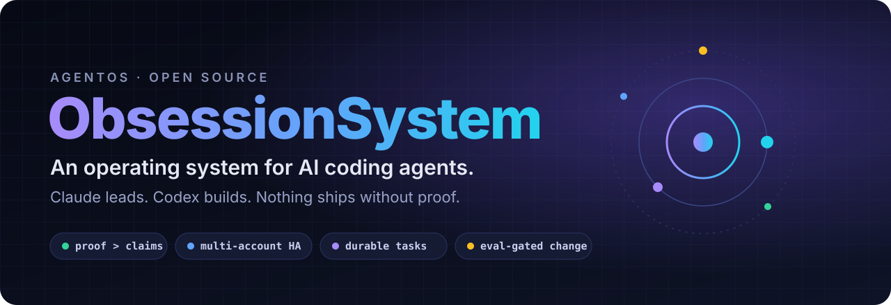
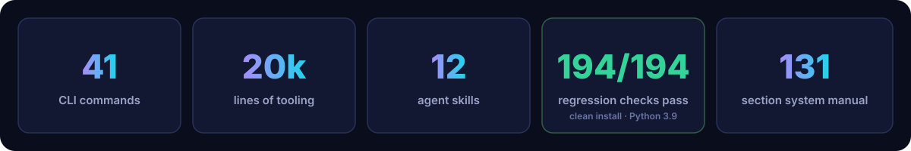
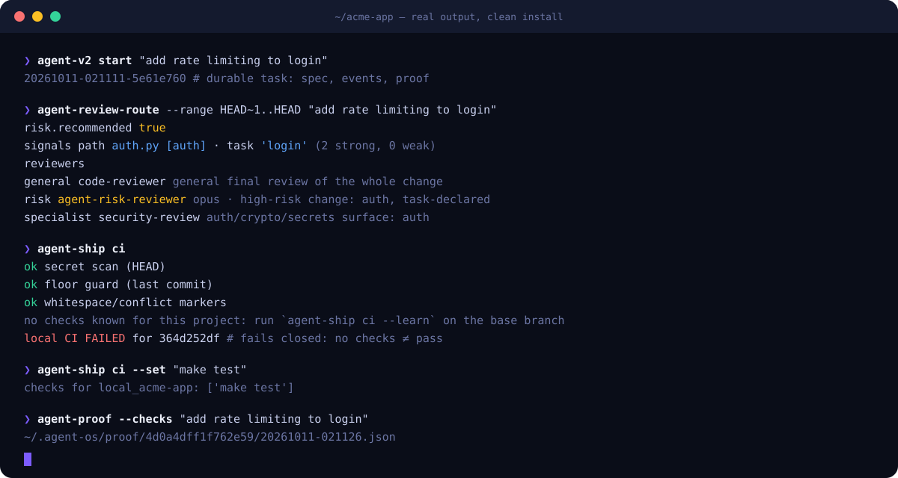
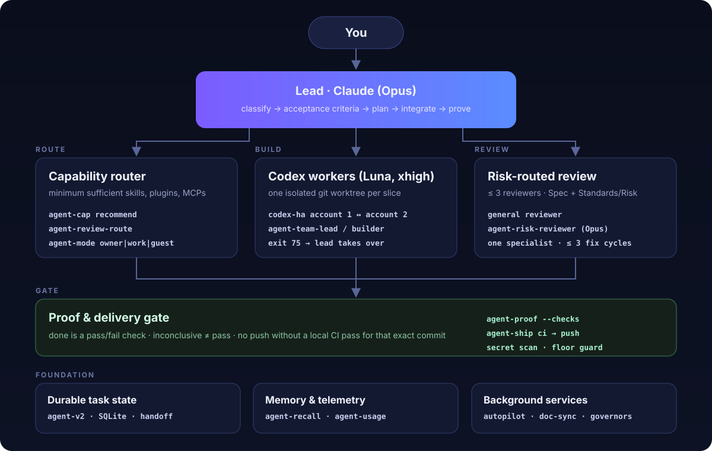
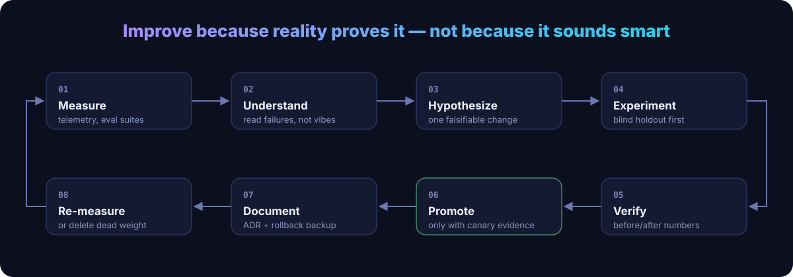

<div align="center">



<br>

[](https://github.com/justAbdulaziz10/ObsessionSystem/actions/workflows/ci.yml)
[](LICENSE)


[](https://github.com/justAbdulaziz10/ObsessionSystem/stargazers)
[](CONTRIBUTING.md)

**Your AI agents are smart. They are not *disciplined*. This makes them disciplined.**

[Quick start](#-quick-start) · [How it works](#-how-it-works) · [Commands](docs/COMMANDS.md) · [Skills](#-skills) · [Evals](#-evals-the-system-tests-itself) · [Manual](docs/SYSTEM.md)

</div>

---

## Why this exists

Coding agents fail in the same handful of ways, over and over:

| Without a system | With ObsessionSystem |
|---|---|
| "Done!" — but nothing was run | **Done is a pass/fail check.** `agent-proof` records it; inconclusive is not a pass |
| Loads 40 skills and 9 MCPs "just in case" | **Minimum sufficient context.** `agent-cap` picks the few that fit, under a hard budget |
| One account hits its limit, work stops | **Failover.** `codex-ha` moves the task to the next account and keeps the worktree |
| Session ends, context is gone | **Durable tasks.** `agent-v2` keeps spec, events and proof in SQLite; `agent-handoff` resumes anywhere |
| Pushes a leaked key, skips a test to go green | **Delivery gate.** `agent-ship` runs a secret scan and a *floor guard* that blocks skipped tests, stripped assertions and loosened lint |
| Every change gets five reviewers, or none | **Risk-routed review.** `agent-review-route` sends auth/payments/migrations to an Opus risk reviewer, everything else stays light |
| Repeats the same mistake forever | **Memory.** `agent-fail remember` stores proven fixes; `agent-recall` finds them; `/correct` turns repeated corrections into guard rails |
| The setup slowly rots into a pile of scripts | **Evidence-gated self-improvement.** Every system change needs before/after numbers and a rollback |

It is not a framework you build an app on. It is the **operating layer that sits above** your Claude Code and Codex accounts, skills, plugins, MCP servers and repositories, so every session, in every project, follows the same rules.

<div align="center">

</div>

## 🎬 What it looks like

Real output from a clean install, not a mock-up. A one-line auth change gets flagged, routed to the Opus risk reviewer and a security specialist, and `agent-ship ci` refuses to call it green until the project actually has checks:



## 🚀 Quick start

```bash
git clone https://github.com/justAbdulaziz10/ObsessionSystem.git
cd ObsessionSystem
./install.sh --dry-run      # see exactly what it will do
./install.sh                # commands, policy, skills, agents
```

That's the safe core: it only **adds** files (symlinks into this checkout, so `git pull` updates you), never overwrites anything you already have, and doesn't touch your Claude settings, git config or background services.

Opt in to the rest when you're ready:

```bash
./install.sh --with-claude-hooks   # telemetry + push guard hooks in ~/.claude/settings.json (backed up first)
./install.sh --with-git-hooks      # global pre-push secret scan + floor guard for every repo
./install.sh --with-launchd        # background upkeep: autopilot, doc sync, governors (macOS)
./install.sh --all                 # all of the above
```

Then:

```bash
agent-system                                        # where everything lives
agent-cap recommend "fix the flaky checkout test"   # which skills/MCPs to load, and which not to
agent-v2 start "add rate limiting to login"         # durable task id
agent-review-route "add rate limiting to login"     # who should review this change
agent-ship ci && agent-ship push                    # gated delivery
```

`./uninstall.sh` removes every link it created and keeps your data (`--purge` to remove that too).

**Requirements:** macOS (Linux works for the CLI; background services are launchd-only for now), Python 3.9+, git. [Claude Code](https://docs.anthropic.com/en/docs/claude-code) and/or the [Codex CLI](https://github.com/openai/codex) for the agents themselves. `gitleaks` is used by the secret scan when present.

## 🧠 How it works



**Brain, hands and session are separate.** Claude (the current Opus model) is the *lead*: it classifies the task, writes acceptance criteria, plans, integrates and proves. Codex workers (Luna at `xhigh` reasoning) are the *hands*: each implementation slice runs in its own git worktree through `codex-ha`, which fails over between accounts and exits `75` when every account is exhausted, so the lead takes over instead of the work silently dying. The *session* is disposable: state lives in `~/.agent-os`, not in a chat window.

A typical substantial task:

1. `agent-v2 start "<request>"` creates a durable task.
2. The lead settles acceptance criteria (`requirements-grilling` when the request is vague).
3. `agent-cap` picks the minimum skills and MCPs (simple tasks: 0–1 skills; complex: at most 5).
4. Work is cut into vertical slices (`agent-team-lead`), each dispatched to a Codex worker in its own worktree.
5. `agent-review-route` picks **at most three** reviewers: one general, one Opus risk reviewer when auth/payments/privacy/schema/production is touched, one specialist. Reviewers judge the diff against the *original requirement*, not the worker's claim, for at most 3 fix cycles.
6. `agent-proof --checks` records pass/fail evidence. A worker saying "done" is not evidence.
7. `agent-ship ci` → `agent-ship push`: secret scan + floor guard + the project's own checks, for that exact commit, then push to GitHub (and fast-forward the GitLab mirror if there is one).
8. `agent-v2 finish <id> --outcome success|partial|failure`: every task ends, even failures, so it can become an eval case.

### Rules it lives by

- **Proof over self-report.** Bugs are reproduced before and after the fix. No performance claim without before/after numbers. No visual claim without looking at the UI.
- **Minimum sufficient everything.** Agents, skills, MCPs, reviewers, context. More machinery is not more intelligence.
- **Bounded retries.** The same failure twice → stop, `agent-recall` the error, change strategy, tool or worker.
- **Humans own the irreversible.** Pushing, merging, releasing, deleting worktrees, publishing: only on request. Unattended workers never push.
- **Modes.** `agent-mode owner|work|personal|guest`. Guest mode never touches private connectors, analytics, billing or company systems.
- **Know broadly, install selectively, load minimally.** New models are *candidates* until canary results promote them; plugin updates are scanned for changed hooks and scripts before they're trusted.

## 🔁 The system improves itself, carefully



Every change to the system itself goes through `agent-system-change begin` / `finish`: a backup before, evidence and an ADR after, and a one-command rollback. Tuning the router? Write a **blind holdout set first**, score it, *then* change code. Example from the real decision log:

> **agent-cap ranker:** name-coverage weighting, history boost gated on relevance (blind holdout written first).
> *Evidence:* trigger top-1 60.6% → 63.6%, top-3 72.7% → 75.8%, false-fire 3.4% → 1.7%; lint 0 errors.

The best harness is the smallest one that keeps producing the strongest verified result, so deleting dead weight counts as an improvement too.

## 🧰 What's inside

```
bin/          41 commands: agent-* CLI, codex-ha, mcpall, agentos2
policy/       GLOBAL.md (routing, budgets, review, proof), V2.md (task lifecycle),
              DELIVERY.md (push/CI/release), AUTONOMY.md (autopilot, worktrees)
agents/       agent-codex-worker, agent-risk-reviewer (Claude Code subagents)
skills/       12 skills: team lead/builder/reviewer/integrator, work loop, diagnosing-bugs, …
evals/        regression suites for ship, autopilot, overnight, telemetry + the cap-router eval
git-hooks/    global hook dispatcher (pre-push guard, then the repo's own hooks)
templates/    config, delivery profiles, Claude hooks, launchd services
docs/         SYSTEM.md (the 131-section manual), COMMANDS.md
```

Full reference: **[docs/COMMANDS.md](docs/COMMANDS.md)**. The highlights:

| Command | What it does |
|---|---|
| `agent-ship` | Evidence-based delivery: topology, local CI, secret scan, floor guard, GitHub-first push with mirror sync, release, tidy |
| `agent-review-route` | Picks ≤ 3 reviewers for a diff from path, content and task signals |
| `agent-cap` | Recommends the minimum skills/plugins/MCPs for a task, within budget |
| `codex-ha` / `agent-codex` | Codex worker pool with multi-account failover and detached jobs |
| `agent-v2` | Durable task lifecycle: start, event, proof, handoff, finish |
| `agent-proof` | Pass/fail proof capture for a task |
| `agent-recall` | One ranked index over decisions, lessons, failures and memory |
| `agent-autopilot` / `agent-overnight` | Unattended upkeep and task queues on `overnight/*` branches, every task gated by a check |
| `agent-skill-lint` | Deterministic SKILL.md linter (no LLM) |
| `agent-system-change` | Backup → change → evidence → ADR → rollback for the system itself |
| `mcpall` | One manifest for MCP servers across every Claude and Codex account |

## 🧩 Skills

Portable [Agent Skills](https://docs.anthropic.com/en/docs/claude-code/skills) (`SKILL.md`), installed to `~/.agents/skills` and shared by every account:

| Skill | Use it when |
|---|---|
| `agent-work-loop` | Ground → design → implement → verify for any substantive change |
| `agent-team-lead` | Work needs several slices or parallel workers |
| `agent-team-builder` | A worker is carrying out one assigned slice |
| `agent-team-reviewer` | Two-axis review (Spec, Standards/Risk) with a SHIP / NO-SHIP verdict |
| `agent-team-integrator` | Several workers' commits need to become one clean history |
| `requirements-grilling` | A request is vague: turn it into checkable acceptance criteria |
| `diagnosing-bugs` | Reproduce → hypothesize → instrument → fix → regression test |
| `create-verification-skill` | A repo has no scripted way to prove behavior: generate `verify-<app>` |
| `maintain-verification-skill` | Keep that verification skill honest as the app changes |
| `correct` | Agents keep repeating a mistake: make it impossible (types, lint, hooks, tests) |
| `writing-skills` | Writing or reviewing a skill to the house standard |
| `agentos-system-governance` | Changing the system itself |

## 🧪 Evals: the system tests itself

One command installs into a throwaway `$HOME` and runs everything (this is what CI runs):

```bash
evals/run-all.sh
```

Or run suites one at a time from a checkout after installing:

```bash
zsh  evals/ship/regression.sh        # 155 checks: topology, CI, floor guard, push, mirrors, statuses
zsh  evals/autopilot/worktrees.sh    #  18 checks: never removes a worktree that holds unsaved work
bash evals/overnight/regression.sh   #   8 checks: deny lists, timeouts, interruption caps, concurrency
bash evals/telemetry/regression.sh   #  13 checks: hook latency, concurrent writers, crash recovery, secret redaction
cd evals/cap-router && python3 run.py holdout3.json   # router accuracy on a blind set
```

All **194/194** regression checks pass on a fresh `$HOME` with the macOS system Python 3.9. Getting there surfaced a real bug, which is fixed here: a background status post whose argument order only Python ≥ 3.12 accepted. The suites run in throwaway temp dirs and never touch your real repos or remotes.

## 🔒 Privacy and safety

- **No secrets, no personal data in this repo.** The secret scan in CI (`gitleaks`) runs on every push; the only matches are deliberate fake keys inside the regression fixtures (allowlisted in `.gitleaks.toml`).
- Telemetry is **local only** (`~/.agent-os/telemetry`), private file modes, and redacts tokens, keys and emails before anything is stored.
- The installer never overwrites your files and backs up `settings.json` before merging hooks.
- `agent-ship` blocks force-pushes to base branches and pushing a mirror before GitHub has the commit; `git push --no-verify` stays a deliberate, human escape hatch.

Found a security issue? See [SECURITY.md](SECURITY.md).

## ❓ FAQ

<details><summary><b>Do I need both Claude Code and Codex?</b></summary>

No. The policy, skills, `agent-ship`, `agent-review-route`, `agent-v2` and evals work with Claude Code alone. When Codex is unavailable, `codex-ha` exits `75` and the lead does the work itself. That path is designed in, not an error.
</details>

<details><summary><b>Do I need two accounts?</b></summary>

No, but failover is built for it: `~/.claude` + `~/.claude_second` and `~/.codex` + `~/.codex_second`. With one account everything still works. The empty second slot fails its auth check and is set aside, so failover just has nowhere to go, and `agent-doc-sync` notes the missing home as a warning. The telemetry and overnight suites expect both config folders to exist (`mkdir ~/.claude_second` is enough).
</details>

<details><summary><b>Linux / Windows?</b></summary>

The CLI is Python + POSIX shell and runs on Linux; background services are launchd today (cron equivalents welcome, see CONTRIBUTING). Windows via WSL.
</details>

<details><summary><b>Which models?</b></summary>

The lead is "the current Opus family" and workers are "the promoted Codex model", never pinned dated versions in prompts. `agent-models` resolves the current IDs; new releases are staged as candidates and promoted only with canary evidence.
</details>

<details><summary><b>Will it slow my sessions down?</b></summary>

The telemetry hook is a shebang-less POSIX script that usually doesn't fork at all; the Stop hook returns in ~30 ms in the regression suite. Everything heavy runs detached or in background services.
</details>

## 🗺️ Roadmap

- [ ] Linux systemd / cron service templates
- [ ] `agent-doctor` first-run wizard
- [ ] Publish the cap-router trigger eval with a public skill catalog baseline
- [ ] Plugin-marketplace packaging for one-command Claude Code install

## 🤝 Contributing

Issues and PRs are welcome. The bar is the same one the system enforces on itself: a pass/fail check for the change, and evidence that it's better. See [CONTRIBUTING.md](CONTRIBUTING.md).

If this changed how you work with agents, **⭐ star the repo**. It helps other people find it.

## 🙏 Credits

Several skills adapt ideas from excellent MIT-licensed work, with notices kept next to each skill: [mattpocock/skills](https://github.com/mattpocock/skills), [addyosmani/agent-skills](https://github.com/addyosmani/agent-skills), pstack by Lauren Tan, and tigerless-labs (agent-memory recall design, autoharness lint rules).

## License

[MIT](LICENSE) © justAbdulaziz10
